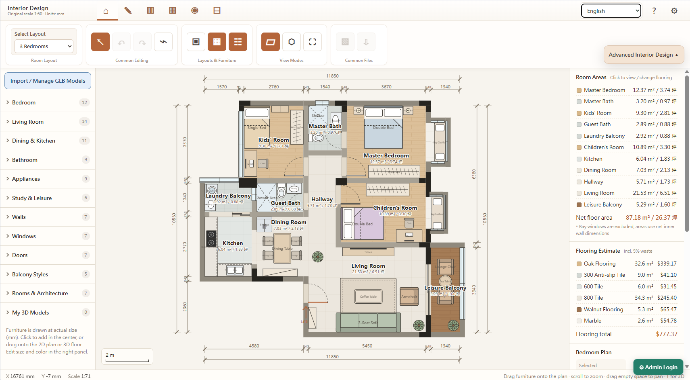
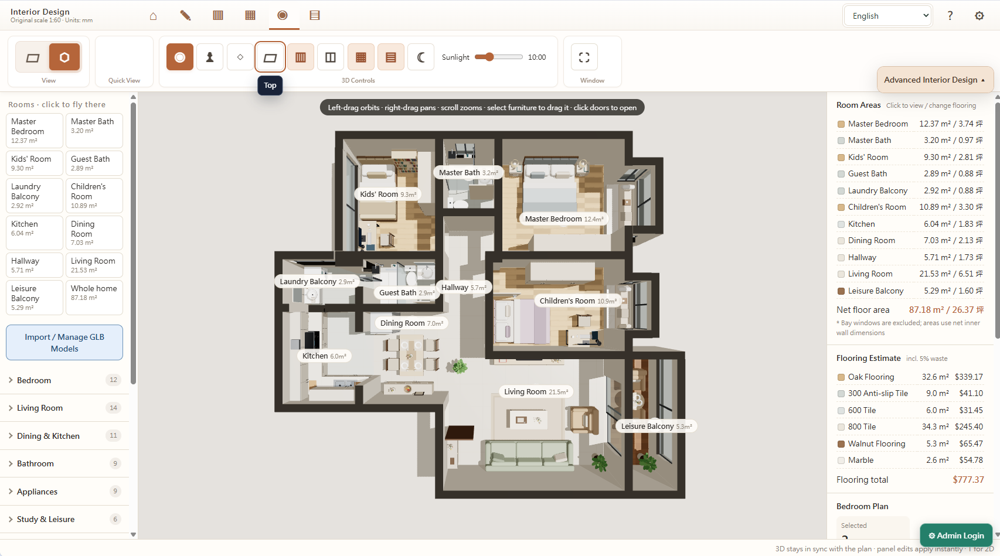
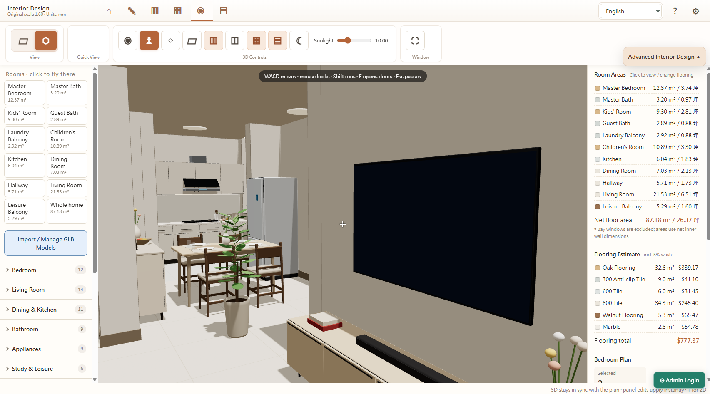

# FloorPlan 3D — Browser-based 2D/3D Floor Planner

**English** · [简体中文](docs/readme/README_zh.md) · [繁體中文](docs/readme/README_zh-TW.md) · [日本語](docs/readme/README_ja.md) · [한국어](docs/readme/README_ko.md) · [Deutsch](docs/readme/README_de.md) · [Español](docs/readme/README_es.md) · [Français](docs/readme/README_fr.md) · [More languages](docs/readme/README.md)

A standalone Vue 3, SVG and Three.js floor planner. Create room layouts, arrange furniture, customize finishes, compare design versions, render 3D scenes and walk through your rooms. The editor runs entirely in the browser, with **no admin login, Cloudflare Worker or D1 database**.

[](https://www.buymeacoffee.com/ecy88214)

## Demo





## Start

Requires Node.js 20 or newer.

```bash
npm ci
npm run dev
```

For production: `npm run build`; deploy the generated `dist/` to any static web host. For deep-link support serve `index.html` as SPA fallback. No environment variables or backend credentials are required.

## Features

- 2D room layout editing, wall and opening tools, measurement and snapping
- 3D preview, navigation, furniture placement, finish and light controls
- Design versions, local backups, CSV/JSON/HTML and image exports
- Multilingual UI (translation completeness varies by locale)

## Attribution & License

Originally inspired by [wy51ai/floorplan-3d](https://github.com/wy51ai/floorplan-3d). Check third-party licenses for embedded models/assets before redistribution. See [MIT LICENSE](LICENSE).
